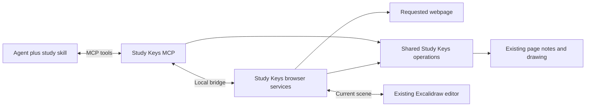

# Study Keys MCP: an agent operates the same Study Keys workspace

Status: core study workflow implemented in 1.6.0, 2026-10-11. The companion MCP is installed and registered with Codex on the development machine. The browser bridge, source capture, highlights/notes, existing-notebook edits/rendering, five-layer compiler, atomic batches, retries and guarded undo are implemented. See [verification](../release/mcp-verification.md) for observed checks.

The Codex skill is maintained in `skills/study-keys` and installed by `native/install_skill.py` or the companion's `--client codex` setup. The remaining sections preserve the wider product roadmap. Proposed navigation/marks tools, library access while Chrome is closed, and complete drawing import/export parity are not included in 1.6.0. The implemented tool schemas returned by `tools/list` are authoritative; the example payload below is conceptual.

## The product contract

An agent using Study Keys MCP can perform the same Study Keys actions as the user: read a page, choose passages, apply the six highlight types, add and edit notes, work on the page's existing Excalidraw canvas, navigate saved locations, and inspect the result.

The user can ask:

```text
study keys -> <website URL>
```

The agent reads and understands the page, highlights useful passages, attaches useful notes, and builds a learn-by-layers explanation with diagrams directly in that page's current Excalidraw notebook. Opening the usual annotation sidebar and `Space d n` reveals the work. All results remain manually editable through the existing interface.

There is one page, one annotation collection and one existing notebook shared by the user and agent. No separate Learn view, learning notebook, learning-pack store or special generated-board selector is required.

## Who does what

The calling agent supplies the understanding and generation. The MCP provides reliable access to the same underlying operations as Study Keys. A companion agent skill/MCP prompt describes the study workflow and the learn-by-layers approach.

`study keys -> URL` is the desired agent instruction, not a universal built-in MCP command syntax. Expose a `study_page` prompt and a portable skill; client-specific slash commands can wrap it. The experience is one user request followed by multiple tool calls. Basic functionality does not require MCP sampling, a second model, or a new model API key in Study Keys.

The high-level write operation accepts an agent-authored set of changes. It validates and applies those changes; it does not pretend to understand a URL by itself. Agents can also use individual tools for small requests such as “make this highlight purple” or “add a retry arrow to my diagram.”

## One complete study run

1. **Open or attach to the exact page.** Reuse a matching tab where possible. Read its live title, URL, article structure, text, code, tables, section IDs and current selection. Signed-in content comes from the page the user can access. Supported local Markdown/HTML follows the same path.
2. **Read existing work.** Obtain highlights, notes, marks and the current Excalidraw scene, with revisions. Find what is already explained and which questions remain open.
3. **Understand and plan.** Identify the main idea, terminology, mechanisms, benefits, limitations, important shifts in understanding and genuine open questions. Use the actual source; follow relevant references only when necessary, and cite any outside material added.
4. **Choose annotations.** Select short, exact passages and classify them. Notes add explanation, a connection, caveat or question rather than repeat the highlighted sentence. Avoid painting every paragraph or forcing every color into every article.
5. **Compose the current notebook.** Arrange layered explanations, native editable diagrams and a worked example in clear frames on the existing canvas. Incorporate existing material where useful; place additions in available space without covering the user's drawing.
6. **Validate and save.** Resolve each passage against the captured source; render the proposed diagram; check IDs, bindings, text bounds and current revisions. Commit the annotation and drawing changes as one logical study operation, with a run ID and recovery information.
7. **Inspect the saved result.** Read back annotations and the saved scene, confirm the browser displays them, and report actual counts plus anything incomplete. Return focus to the main overview if requested.

This explicitly requested automatic study workflow can populate all useful layers in one run. The companion skill should document that as its full-study mode. The original conversational learn-by-layers behavior—layers 1–3 followed by a checkpoint—remains appropriate for “explain this” requests. No layer should be padded just to fill a template.

## Highlight policy

| Existing type | Agent's use | Note when helpful |
|---|---|---|
| Yellow — Key idea | The central claim, rule or mechanism | Why it matters; when it applies |
| Blue — Key word | A term, API name or concept worth learning | A short definition in this context |
| Green — Positives | An explicit benefit, strength or useful guarantee | Conditions under which the benefit holds |
| Orange — Negatives | A limitation, cost, failure mode or trade-off | Practical consequence or mitigation |
| Purple — Game changer | A high-impact insight that changes the mental model | What assumption it changes |
| Bright red — Question | A passage needing clarification or further thought | The actual unresolved question |

Highlight quotations must be present in the source. A conceptual inference belongs in the note or canvas and must be labeled as explanation, not fabricated as a quotation. A red question does not mean the author is wrong, and the agent must not automatically mark existing questions resolved.

Use the existing quote/prefix/suffix anchor representation. Source block IDs and offsets make selection reliable; resolve against the current normalized text before saving. If content changes or a repeated quotation is ambiguous, recapture or return an unresolved target rather than guessing.

## Learn by layers inside the current Excalidraw notebook

The notebook itself contains the teaching content. Text cards and diagrams are editable native Excalidraw elements, not a screenshot pasted onto the canvas.

| Frame | Content on the canvas |
|---|---|
| 1 · Core idea | A short plain-language statement and, if useful, a tiny overview |
| 2 · Intuition | A mental model or analogy with its relevant limits |
| 3 · Key mechanics | Components, relationships, sequence and essential rules |
| 4 · Deep detail | Failure paths, edge cases, constraints and trade-offs |
| 5 · Worked example | A concrete walkthrough with numbered diagram steps |

Use one coherent visual vocabulary and keep frames readable. Prefer a small architecture/sequence/state diagram over walls of prose. Create only the diagrams that teach something. Source references and explanatory notes can be included as text and element metadata; opening a source passage needs a Study Keys action because the current editor suppresses arbitrary diagram-link navigation.

An existing useful diagram can be extended or labeled. Existing content should be moved, removed or rewritten only when that is part of the user's requested edit. Normal automatic study adds material and avoids duplicating what is already present. Layout should account for the bounds of existing elements, including frames.

Frames are organizational regions within the same scene. The existing floating, docking, resizing, maximizing and save/close behavior stays in use. A focus-frame tool can move the viewport; a separate reading mode is unnecessary.

## Proposed MCP surface: manual-action parity

Names are proposed and may be consolidated during implementation. All mutations accept expected revisions where applicable.

| Capability | Proposed tools and operations |
|---|---|
| Page access | `open_page`, `read_page`, `read_selection`, `reveal_section`, `find_passage` |
| Highlights | `list_annotations`, `create_highlight`, `update_annotation` including recolor/reanchor, `archive_annotation`, `restore_annotation` |
| Notes | `add_note` attached to a passage/highlight or page; edit through `update_annotation` |
| Notebook | `get_notebook`, `open_notebook`, `apply_drawing_operations`, `render_notebook`, `focus_drawing` |
| Drawing actions | Add, edit, move, resize, group, frame, connect, duplicate or delete identified elements; add text; import/export a scene |
| Reading navigation | Read/set/jump marks, jump to a highlight/section, search the library; expose existing quick-spot, workspace and tab-group actions through the same services |
| Study operation | `apply_study_changes`, `get_study_run`, `undo_study_run` with conflict checks |

The goal is semantic parity with Study Keys, not simulated keystrokes. A create-highlight call should call the shared annotation operation; it should not make an agent type word labels. Drawing tools should operate on IDs and geometry, not rely on mouse coordinates. Browser capabilities and required user gestures must be reported honestly if a UI action cannot be invoked remotely.

For diagrams, offer both a concise semantic graph compiler and direct element operations. Agents can use the graph route for a new explanation and precise patches when editing an existing hand-drawn scene. Tool responses include canonical IDs, revisions, a preview when relevant and typed errors.

A proposed batch payload:

```json
{
  "page_id": "resolved-page-id",
  "source_snapshot_id": "captured-snapshot-id",
  "expected_annotations_revision": "annotations-revision",
  "expected_drawing_revision": "drawing-revision",
  "request_id": "unique-study-run-id",
  "annotations": [
    {
      "operation": "create",
      "anchor_ref": {"block_id": "source-block-id", "start": 0, "end": 42},
      "color": "yellow",
      "note": "Why this exact passage matters."
    }
  ],
  "drawing_operations": [
    {
      "operation": "add_frame",
      "client_id": "layer-1",
      "name": "1 · Core idea",
      "placement": "next_available_space"
    }
  ]
}
```

This is an illustrative shape, not an executable example: real block IDs, offsets, revisions and complete diagram content come from the current page and scene. `apply_study_changes` returns committed annotation/element IDs and saved revisions, never merely echoes the proposed plan.

## Shared state and persistence

Keep using the current page folder:

```text
~/.study-keys/pages/<existing-domain>/<existing-page-id>/
  page.json
  annotations.json          # user and agent highlights/notes together
  notes.md                  # generated readable view of those annotations
  drawing.excalidraw         # the existing canvas, now also edited by the agent
  drawing.json              # existing scene revision metadata
  marks.json
  recovery/                 # retained conflict/recovery scenes when needed
  agent-runs/<run-id>.json   # proposed operation/provenance/undo metadata
```

Local Markdown/HTML retains its existing `pages/local-files/` organization. Never write teaching content directly into generated `notes.md`; use the annotation API or canvas. Runtime connection data remains under the ignored `.integration/` directory. Run metadata should be bounded, include only necessary data, and be included in backup handling when needed for recovery.

Optional author/run/source metadata on annotations and Excalidraw elements enables provenance and safe reruns without creating a second class of notebook. Existing manual editing works on all records. Do not change meaning or overwrite a user-modified element just because it was originally agent-generated.

## Architecture and concurrency



Use stdio for the MCP process. Add a local authenticated bridge to the existing Native Messaging helper/extension for page capture, live editor coordination and browser actions. Library-only operations can work with Chrome closed, but the complete `study keys -> URL` workflow includes the browser bridge from its first end-to-end version; otherwise it cannot reliably access the user's current page and editor.

Reuse existing URL canonicalization, annotation normalization, scene checks, directory restrictions, expected-version writes and library lock. Bring JavaScript repository rules and Python disk validation into one supported operation contract; test both adapters against the same fixtures rather than letting MCP bypass validation. No arbitrary shell execution, browser evaluation or filesystem path writes are required by the MCP.

For an open notebook, a read must account for the current editor draft. Flush a healthy draft through its normal save path or explicitly report an unsaved/conflicted editor; do not pretend the older disk scene is current. Apply agent patches against the expected scene revision, then refresh a clean editor through the editor API. If the user edits while the agent is thinking, reject a stale patch and let the agent rebase. Preserve drafts on both repository and native file-hash conflicts.

For an unopened notebook, patch the saved scene under the same lock and revision rules. After successful external writes, notify the extension to invalidate only the relevant page and refresh its annotations. Disk writes alone do not trigger the current Chrome storage notifications.

For a batch of annotations plus drawing operations: validate all targets and revisions first, then use the existing journal/recovery model extended to the logical batch. Report completion only after commit and readback. An interrupted run should be retryable with its request ID. Repeated study requests should compare existing annotations/elements before adding duplicates.

Undo removes or restores that run's changes only if their current revisions still match the run's recorded output. A later manual edit must not disappear when undoing an earlier agent operation.

## Capture, understanding and verification

The current library stores saved passages, not a complete copy of every article. Read the requested live document and return stable source blocks, headings, code/tables, exact URL, capture time, content hash and coverage. Read-only expand/reveal actions should target observed sections, not arbitrary page buttons. Treat page content as source material, never as instructions to the agent.

Partial access, collapsed/unloaded content, unsupported frames and canvas-only text must be reported. Local-file support uses the documents already permitted/opened; reading a URL is not a request to crawl its whole site or inspect unrelated tabs.

The agent reviews factual relationships and cites outside context. The MCP checks passage matches, schema, scene references, size limits, allowed assets and readable geometry. A valid scene is not proof that its explanation is correct. Render the proposed canvas, inspect labels/arrows/overlap at desktop and narrow sizes, repair if needed, then verify persisted results.

Storage and rendering are local. When a cloud agent reads the requested content, that content is processed by its model provider. The MCP need not send anything to a separate generation service.

## What counts as finished

The first complete release should prove this exact journey on a normal website, a signed-in page and local Markdown/HTML:

1. Invoke the study workflow from a fresh MCP client for a URL.
2. Agent reads the source and existing work, then adds selective palette-correct highlights and useful notes.
3. The usual Study Keys sidebar displays those annotations and jumps to the exact passages.
4. The usual notebook contains editable layered explanations and diagrams alongside any earlier drawing.
5. User edits a shape or note; the agent reads that change and can extend it without losing it.
6. Reload/browser restart/MCP restart and backup restoration preserve the same results.
7. Stale patches, missing passages, interrupted saves and retries behave correctly; undo cannot overwrite later manual work.

Build order: shared operations and source/browser bridge; annotation parity; notebook read/render/patch and live-editor coordination; study skill and batch orchestration; remaining navigation/export parity and end-to-end verification. No separate learning-product UI is part of this scope.

## Design references

- User-supplied learn-by-layers skill: five progressive levels, source grounding, concise explanations and useful diagrams.
- [MCP transports](https://modelcontextprotocol.io/specification/2025-11-25/basic/transports): local stdio transport.
- [Excalidraw API](https://docs.excalidraw.com/docs/@excalidraw/excalidraw/api/props/excalidraw-api): scene and viewport integration.
- [Excalidraw utilities](https://docs.excalidraw.com/docs/@excalidraw/excalidraw/api/utils): serialization/restoration/rendering support; implementation must use and test the installed package version.
